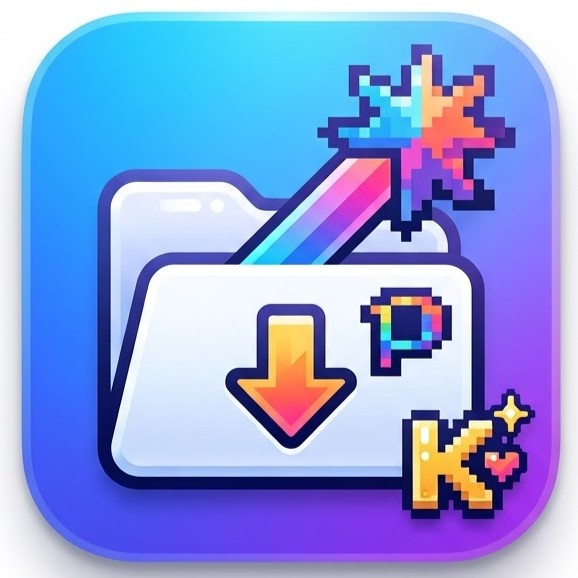

<div align="left">



# PixKura (蔵) — Version 2.4.0-V.32
### *by Kurito*

**A high-performance, memory-efficient desktop illustration vault, account-safe downloader & AI tag classifier for Pixiv artworks.**

[](https://www.python.org/)
[](https://riverbankcomputing.com/software/pyqt/)
[](https://github.com/microsoft/DirectML)
[](LICENSE)
[](#installation--setup)

[Key Features](#key-features) • [Architecture](#system-architecture--technical-workflow) • [Installation & Setup](#installation--setup) • [Quick Start](#first-time-quick-start) • [File Structure](#file-structure) • [Changelog](CHANGELOG.md) • [Future Roadmap](future_plan.md) • [Disclaimer](#disclaimer)

---
</div>

**PixKura (蔵)** is a high-performance desktop application built in Python and PyQt6. Designed as an art vault (*Kura - 蔵*) by Kurito, it allows users to browse, index, manage, tag, download, deduplicate, export datasets, and search massive locally downloaded Pixiv artwork collections. By leveraging an SQLite database cache, viewport-based lazy loading, an asynchronous background processing engine, and a DirectML/OpenVINO/QNN-accelerated local Vision AI inference engine, PixKura smoothly indexes and classifies libraries containing hundreds of thousands of files with maximum hardware efficiency.

## Key Features

### 1. Local GPU & NPU AI Character & Tag Classifier (DirectML / OpenVINO / QNN)
* **Multi-Model Registry & Ensemble Engine (WD14 & WD v3 Series)**: Built-in support for **WD14 ConvNeXt v2**, the latest **WD Tagger v3 Series** (`ConvNeXt`, `ViT`, `SwinV2`, `EVA02-Large`, `ViT-Large`), **Standard Ensemble (3-in-1)**, and **👑 WD Tagger v3 Ultra Ensemble (EVA02-Large + SwinV2 + ConvNeXt)** using Soft-Voting Probability Averaging for top-tier character detection and false-positive noise reduction.
* **Universal GPU & NPU Acceleration**: Native DirectX 12 (`DirectML`), `CUDA`, `OpenVINO` (Intel Core Ultra NPU / Arc), and `QNN` (Snapdragon X Elite NPU) acceleration.
* **FP16 Half-Precision Optimization**: Automated conversion of ONNX models to FP16 half-precision, cutting VRAM consumption by 50% and utilizing native Rapid Packed Math (RPM) for 2x mathematical throughput.
* **Configurable Dynamic Batched GPU Inference (`Batch = 4 / 8 / 16 / 32`)**: Eliminates GPU kernel launch latency by stacking image tensors per run, boosting tagging speed to **~200–290 FPS** (~14 minutes for 250,000+ images) while adapting to any VRAM capacity.
* **Alpha-Aware C++ OpenCV Image Preprocessing**: Uses `cv2.imdecode` (`IMREAD_UNCHANGED` via `np.fromfile` for 100% Unicode path support) and composites 4-channel transparent PNGs onto a pure white `(255, 255, 255)` background before resizing to release Python's GIL and ensure accurate tag prediction on transparent line art and stickers.
* **Adaptive Storage Engine (Auto HDD vs SSD)**: Automatically detects physical drive media (`HDD` vs `SSD`); applies directory-based file sorting (`sort by dirname`) and limits I/O concurrency to 3–4 threads on spinning HDDs to eliminate mechanical head thrashing, while scaling to 16 threads on NVMe/SATA SSDs.
* **Real-time Stopwatch & Metrics**: Live running stopwatch timer (`⏱️ ใช้ไป: mm:ss`), auto-freezing upon completion, paired with monotonically stable real-time average FPS and accurate ETA remaining countdown.
* **Quick Mode, Full Re-scan & Unknown Character Re-scan**: Dedicated scan mode selector defaulting to **Quick Mode** (scans only untagged files, automatically skipping files with existing tags in SQLite) alongside **Full Re-scan** mode, plus a dedicated **🔍 Re-scan Unknown Characters** option to specifically re-evaluate previously tagged images that still lack recognized character tags.

### 2. Curated Collections, Duplicate Finder & LoRA Dataset Exporter (V.32)
* **⭐ Favorites & Custom Manual Tags**:
  * Bookmark any artwork with a single click (`⭐ Favorite` button in Lightbox, keyboard shortcut `S`, or right-click context menu in gallery grids).
  * Add custom manual tags (`category=2`) directly in the Lightbox sidebar (`+ tag_name`) or filter favorites instantly via the toolbar `⭐ Favorites` button or `is:fav` / `is:favorite` query syntax.
* **🔍 Duplicate & Similar Artwork Finder (Perceptual dHash)**:
  * Computes 64-bit Difference Perceptual Hashes (`dHash`) across your library (`dhash` column in `file_index`) to detect exact duplicates, multi-folder copies, and resized variations using configurable Hamming distance thresholds (`0` to `10`).
* **📦 One-Click Dataset Exporter for LoRA / Kohya_ss / Google Colab**:
  * Exports any search query or character filter (with optional **Strict SFW Guard**) into a ready-to-train folder containing images alongside matching `.txt` caption files (`trigger_word, character, series, general_tags`).

### 3. Security & Privacy Hardening (V.32)
* **Windows DPAPI Credential Encryption**: Automatically encrypts sensitive credentials (`pixiv_cookie` and `danbooru_api_key`) in `config.json` using Windows Data Protection API (`CryptProtectData` bound to your Windows user account) with atomic `.tmp` file replacement (`update_app_config`) to prevent race-condition corruption.
* **Zip Bomb & Memory Exhaustion Shield**: Enforces frame count and uncompressed byte limits (`MAX_UGOIRA_FRAME_BYTES`, `MAX_UGOIRA_TOTAL_BYTES`, `MAX_UGOIRA_FRAMES`) across Ugoira ZIP readers and Lightbox previews.
* **HTML Injection Sanitization & Model Download Verification**: Escapes untrusted filenames/tags in rich-text UI components (`html.escape`) and verifies exact byte length (`Content-Length`) before finalizing ONNX model downloads.

### 4. Universal Minimizable Dialogs Architecture (V.31+)
* **Unified `MinimizableDialog` Base Class**: All dialogs (`PixivDownloadDialog`, `AiTagDialog`, `DashboardDialog`, `SearchHelpDialog`, `LightboxViewerDialog`, `DatasetExporterDialog`, `DuplicateFinderDialog`) inherit standard window control hints (`WindowMinimizeButtonHint` and `WindowMaximizeButtonHint`).
* **Two-Way Windows Taskbar Synchronization**:
  * Clicking the **Minimize `[-]`** button on any active dialog immediately minimizes both the dialog and the parent `QMainWindow` simultaneously to the Windows Taskbar.
  * Restoring the application from the Windows Taskbar smoothly brings the main window and active dialog right back to the front.

### 5. Ultra-Low Memory & Fluid Scrolling Across All Views
* **Viewport-Based Icon Architecture (92% RAM Reduction)**: Replaced full-memory `QPixmap` instantiations with in-memory compressed raw byte storage (~10 KB per folder), slashing memory usage from **3,775 MB to ~303 MB** across Folder, File, and Detail views.
* **Smooth Lookahead Overscan Buffer**: Pre-renders items ahead (120 items below, 50 items above) to eliminate gray placeholder boxes during fast scrolling.
* **Bounded LRU Cache (`OrderedDict`)**: Keeps recently browsed items in memory for instant 0ms response when scrolling up/down, while strictly enforcing memory safety limits across all 3 views (`folder_icon_cache`, `file_icon_cache`, `detail_icon_cache`).

### 6. High-Performance Caching, Indexing & Orphan Cleanup
* **SQLite Backend**: Caches folder structures, file details, file sizes, modification times (`mtime`), perceptual hashes (`dhash`), pre-generated image thumbnails, and AI/custom tags.
* **Automatic Orphaned Record Cleanup**: Automatically purges stale entries from `file_tags` and `file_thumbnails` when files or folders are deleted during Quick Sync or Database Optimization (`VACUUM`), while preserving manual favorites and custom tags during AI re-scans.

### 7. Advanced Boolean Search & Content Safety Engine
* **Comprehensive Boolean Logic Engine**: Full support for `AND`, `OR`, `NOT`, and `NOR` operators across database tags and filenames:
  * **Conjunction (`AND`, `&&`, or Space)**: e.g. `solo 1girl swimsuit`, `tag:crossed_legs AND tag:toes`, `1girl && barefoot`.
  * **Alternative (`OR`, `||`)**: Multi-tag alternatives with prefix stripping and chaining, e.g. `cat_ears OR dog_ears OR fox_ears`, `tag:a || tag:b`.
  * **Exclusion & Negation (`NOT`, `-`, `!`)**: e.g. `solo -glasses`, `tag:swimsuit NOT tag:glasses`, `solo !hat`.
  * **Neither / Nor (`NOR`)**: e.g. `cat_ears NOR dog_ears`, `tag:a NOR tag:b` (excludes both tags simultaneously).
* **Strict Safety & Rating Filtering (Colab-Proof)**:
  * Dropdown selector and syntax commands (`rating:sfw`, `rating:nsfw`, `rating:sensitive`, `rating:all`).
  * Hybrid classification algorithm cross-referencing AI tagger rating categories (5, 9) and explicit NSFW anatomical keywords (`nude`, `nipples`, `sex`, etc.) with 0% overlap.
* **Prefix Search**: Supports `char:`, `series:`, `artist:` (matches artist display names & folder IDs), `tag:` (B-Tree index-first lookup), `is:fav` / `is:favorite`, `type:` (`mp4`, `gif`, `video`, `png`), and `size:` (`>5mb`, `<1mb`).

### 8. Account-Safe Pixiv Download Manager & Native `.mp4` Ugoira Engine (V.32)
* **Native `.mp4` Ugoira Conversion**: Automatically compiles downloaded Ugoira animation frames and variable per-frame delays into smooth, high-efficiency `.mp4` video files (eliminating GIF's 256-color quantization artifacts and cutting file sizes by 70–85%), with automatic fallback to `.gif` if OpenCV is unavailable.
* **Smart URL Auto-Extraction**: Directly paste full Pixiv URLs (e.g. `https://www.pixiv.net/artworks/76691698` or `https://www.pixiv.net/users/7819951`); the dialog automatically extracts numeric IDs and switches modes seamlessly.
* **DPAPI-Encrypted Cookie Persistence**: Securely remembers optional `PHPSESSID` session cookies in `config.json` encrypted via Windows DPAPI.
* **Zero-Freeze Instant Cancellation & Partial File Shield**: Powered by `interruptible_sleep`, canceling long download queues aborts in <0.3s and automatically purges incomplete 0-byte files.

---

## System Architecture & Technical Workflow

PixKura is designed specifically to solve the performance bottlenecks of managing massive digital artwork libraries (100,000+ images / 15,000+ artist folders) without memory bloat or UI freezes.

```
┌─────────────────────────────────────────────────────────────────────────┐
│                           Main Thread (PyQt6 UI)                        │
│   ┌─────────────────────┐   ┌─────────────────┐   ┌─────────────────┐   │
│   │ QListView (Folders) │   │ QListView(Files)│   │  Search / Filter│   │
│   └──────────┬──────────┘   └────────┬────────┘   └────────┬────────┘   │
│              │                       │                     │            │
│   ┌──────────┴───────────────────────┴─────────────────────┴────────┐   │
│   │     ThumbnailListModel (MVC Data Model + In-Memory LRU Cache)    │   │
│   └──────────────────────────────────┬──────────────────────────────┘   │
└──────────────────────────────────────┼──────────────────────────────────┘
                                       │ Signals / Slots
┌──────────────────────────────────────┴──────────────────────────────────┐
│                   Asynchronous Multithreaded Engine                     │
│  ┌─────────────────┐  ┌──────────────────┐  ┌────────────────────────┐  │
│  │    scan_pool    │  │     fg_pool      │  │        bg_pool         │  │
│  │ (Disk Scanning) │  │(Viewport Loader) │  │  (Thumbnail Generator  │  │
│  │  [Max 1 Thread] │  │ [Max 4 Threads]  │  │   & Caching Engine)    │  │
│  └────────┬────────┘  └────────┬─────────┘  │    [Max 6 Threads]     │  │
│           │                    │            └───────────┬────────────┘  │
│           │                    │                        │               │
│           │   ┌────────────────┴────────────────────────▼────────┐      │
│           │   │     AI Tagging Pipeline (DirectML / OpenVINO)    │      │
│           │   │ [BGRA->White OpenCV (16T)] ➔ [Batch=4..32 FP16]  │      │
│           │   └────────────────────────┬─────────────────────────┘      │
│           │                            │                                │
│           └────────────────────┬───────┘                                │
│                                │ Thread-Safe Queries                    │
│                     ┌──────────▼──────────┐                             │
│                     │  SQLite Database    │                             │
│                     │   (WAL Mode +       │                             │
│                     │  Thread-Local Pool) │                             │
│                     └─────────────────────┘                             │
└─────────────────────────────────────────────────────────────────────────┘
```

---

## Installation & Setup

### Prerequisites
* **Python 3.9 – 3.12** is recommended.
* **DirectX 12 Compatible GPU** (AMD Radeon, NVIDIA GeForce, or Intel Arc) or NPU for hardware AI acceleration on Windows.
* **Git** (for cloning the repository).

### Step-by-Step Installation

1. **Clone the repository**:
   ```bash
   git clone https://github.com/kjanard/PixKura.git
   cd PixKura
   ```

2. **(Recommended) Create and activate a Virtual Environment**:
   * **Windows (Command Prompt / PowerShell)**:
     ```bash
     python -m venv .venv
     .venv\Scripts\activate
     ```
   * **Linux / macOS**:
     ```bash
     python3 -m venv .venv
     source .venv/bin/activate
     ```

3. **Install required dependencies**:
   ```bash
   pip install -r requirements.txt
   ```

4. **Launch the application**:
   * **Option A (One-Click Launcher for Windows)**:
     Double-click `run.bat` to launch the app cleanly in the background without an intrusive console window (or run `run.bat --console` for live debug output, or `run.bat --test` to run the automated unit test suite).
   * **Option B (Command Line)**:
     ```bash
     python main.py
     ```
   * **Option C (Run Automated Unit Tests)**:
     ```bash
     python -m unittest discover -s tests -p "test_*.py" -v
     ```

---

## File Structure

```
pixkura/
├── main.py                 # Application entry point, main window layout, and UI event orchestration
├── query_parser.py         # Advanced Danbooru boolean parser, artist/favorite resolvers, and hybrid SFW/NSFW engine
├── dashboard_dialog.py     # Visual Dashboard & Interactive Tag Cloud for library analytics, safety ratios, and characters
├── lightbox_viewer.py      # Fast In-App Image/Video Viewer with zoom/pan, favorites, custom tags, and AI metadata sidebar
├── danbooru_api.py         # High-efficiency Danbooru REST client (DanbuDL engine) with rate limiting, retries, and artist resolution
├── tagger.py               # Local AI Tagger engine (WD14 & WD v3 series) with DirectML/OpenVINO/QNN, FP16, and batched inference
├── ai_tag_dialog.py        # Standalone dialog for AI Model Management, Batch Size selector, Storage Profile, and live progress
├── download_dialog.py      # Standalone dialog for Account-Safe Pixiv Download Manager (URL parser, R-18, MP4 Ugoira)
├── models.py               # MVC components including ThumbnailListModel for high-performance QListView rendering
├── workers.py              # Multithreaded background workers (QRunnable) for SQL indexing, MP4 Ugoira, dHash, Dataset Export, and AI
├── components.py           # Custom UI classes (MinimizableDialog, SearchHelpDialog, DatasetExporterDialog, DuplicateFinderDialog)
├── style_sheet.py          # QSS styling rules defining the dark theme aesthetics
├── utils.py                # Helpers for media decoding, dHash calculation, NPU detection, and drive media type detection (HDD/SSD)
├── database.py             # SQLite table schemas, migration scripts, favorites/custom tags, and orphan cleanup helpers
├── config.py               # AI model registry, DPAPI secret encryption, atomic config read/write, and global limits
├── config.json.example     # Configuration template for GitHub users (safe, without personal credentials)
├── tests/                  # Dedicated automated unit test suite directory
│   ├── __init__.py         # Test package initializer
│   ├── test_ai_tagger.py   # Unit tests covering AI tagging, ONNX providers, FP16, database schema, and workers
│   ├── test_query_parser.py# Unit tests for boolean parsing, DPAPI encryption, artist/favorite queries, and safety filtering
│   └── test_ui_dialogs.py  # Unit tests for Dashboard, Lightbox, MP4 Ugoira, RGBA OpenCV, dHash, Dataset Export, and Dialogs
├── CHANGELOG.md            # Comprehensive history of all version releases, features, and bug fixes
├── future_plan.md          # Technical roadmap for SoC NPU acceleration, Hailo-10H M.2 coprocessors, and hybrid computing
├── run.bat                 # One-click Windows bootstrapper script with venv detection (--console & --test support)
├── requirements.txt        # Python package dependencies with cross-platform fallbacks
├── LICENSE                 # Non-Commercial & Share-Alike software license
└── .gitignore              # GitHub exclusion rules (protects database, models, cookies, and temp media)
```

---

## Disclaimer

*Pixiv is a registered trademark of pixiv Inc. PixKura is an independent, unofficial open-source tool created by Kurito and is not affiliated with, sponsored by, or endorsed by pixiv Inc. All product names, logos, and brands are property of their respective owners.*

---

## License

This project is licensed under the **Custom Non-Commercial & Share-Alike License (NC-SA 1.0)** - see the [LICENSE](LICENSE) file for details.
